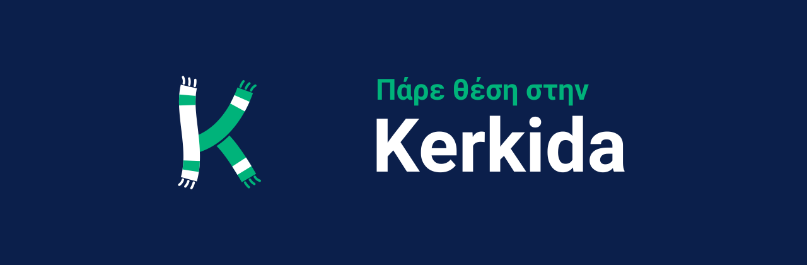

<p align="center">
  
</p>

<p align="center">
  Αγώνες, μεταδόσεις, highlights και γήπεδα κοντά σου, σε μία web εφαρμογή φτιαγμένη για τον Έλληνα φίλαθλο.
</p>

<p align="center">
  <a href="https://nikosanat.github.io/kerkida-web/"><strong>Άνοιξε την Kerkida</strong></a>
</p>

## Λειτουργίες

- **Αγώνες:** ημερολόγιο, όλα τα αθλήματα της εφαρμογής, φίλτρα για ζωντανά, αγαπημένα και αγώνες στην TV.
- **Όλες οι λίγκες:** κατάλογος εκατοντάδων διοργανώσεων, με επιλογή όσων ακολουθείς.
- **Ελληνικά πρωταθλήματα:** Super League, Super League 2, Γ΄ Εθνική, Κύπελλο, Stoiximan GBL, Elite League και Volley League.
- **Σελίδα αγώνα:** φάσεις, επίσημα highlights, ενδεκάδες, φωτογραφίες, βαθμολογίες παικτών με εξήγηση, προεπισκόπηση και ιστορικό μεταξύ των ομάδων.
- **Χωρίς spoilers:** ένα μάτι κρύβει σκορ, φάσεις, ενδεκάδες και βίντεο, και μπορεί να εφαρμόζεται αυτόματα στις ομάδες σου.
- **Στην TV:** πρόγραμμα, προτάσεις για απόψε, φίλτρα, αγαπημένες μεταδόσεις, αντιστοίχιση στον πραγματικό αγώνα και κουμπί Nova TV.
- **Highlights:** μόνο από επίσημα κανάλια, με φίλτρα ανά πηγή και για τις ομάδες σου.
- **Κοντά μου:** λίστα και χάρτης με τους αγώνες ανά γήπεδο και οδηγίες διαδρομής.
- **Ομάδες:** αγώνες, βαθμολογία και προφίλ συλλόγου με ιστορία, τίτλους και γήπεδο.
- **Το Σαββατοκύριακό μου:** πρόταση προγράμματος, συμπίπτοντες αγώνες και ώρα αναχώρησης.
- **Η σεζόν μου:** αγώνες που είδες ή πήγες, με στατιστικά.
- **Fantasy:** deadline, παίκτες σε φόρμα και πόντοι για την ομάδα που φτιάχνεις.
- **Ημερολόγιο:** εξαγωγή αγώνα, ομάδας ή Σαββατοκύριακου σε αρχείο για κάθε εφαρμογή ημερολογίου.
- **Ειδοποιήσεις και εκφώνηση:** κόκκινες, γκολ στο τέλος και ανατροπές, όσο το site είναι ανοιχτό.
- **Ρυθμίσεις:** ελληνικά ή αγγλικά, θέμα, κανάλια και διακόπτης για κάθε λειτουργία.
- **Κίνηση:** τα κασκόλ σχηματίζουν το logo, με μπάρα φόρτωσης σε μορφή κασκόλ.

## Πώς δουλεύει

Το site είναι στατικό και τρέχει στο GitHub Pages, χωρίς δικό του server ή λογαριασμούς.

- Τα αποτελέσματα φορτώνονται απευθείας από τον browser.
- Το πρόγραμμα TV, τα highlights και τα ελληνικά πρωταθλήματα ανανεώνονται αυτόματα κάθε 3 ώρες από ένα GitHub Action.
- Αγαπημένα, ρυθμίσεις και κρυφοί αγώνες μένουν μόνο στον browser σου.
- Η τοποθεσία χρησιμοποιείται μόνο όταν τη ζητήσεις και δεν αποθηκεύεται. Ο χάρτης φορτώνει εικόνες της περιοχής από το OpenFreeMap.

## Περιορισμοί

- Το Fantasy δεν συνδέεται με λογαριασμό FPL, γιατί το επίσημο API δεν επιτρέπει κλήσεις από browser. Η ομάδα φτιάχνεται μέσα στο site.
- Οι ειδοποιήσεις δουλεύουν μόνο όσο το site είναι ανοιχτό.
- Δεν περιλαμβάνονται τα τοπικά πρωταθλήματα ΕΠΣ, γιατί βασίζονται σε μικρές τοπικές σελίδες.
- Τα ελληνικά πρωταθλήματα χωρίς live πηγή, το πρόγραμμα TV και τα στοιχεία Fantasy ενημερώνονται κάθε 3 ώρες.
- Τα δεδομένα εξαρτώνται από εξωτερικές πηγές που μπορεί να αλλάξουν ή να μην είναι διαθέσιμες.

## Τοπική εκτέλεση

```bash
python -m http.server 8000
python scripts/fetch_data.py
node --test "tests/*.test.mjs"
```

## Πηγές

ESPN, EuroLeague, ΕΣΑΚΕ, the-sports.org, TheSportsDB, Fantasy Premier League, Wikipedia, Wikimedia Commons, ΣΠΟΡ FM, κοινοτικός οδηγός XMLTV, RSS επίσημων καναλιών YouTube, Wikidata. Χάρτης: © OpenFreeMap, © OpenMapTiles, © [OpenStreetMap contributors](https://www.openstreetmap.org/copyright). Χρησιμοποιεί [MapLibre GL JS](https://maplibre.org/).

## Νομική σημείωση

Η Kerkida είναι ανεξάρτητο έργο και **δεν συνδέεται, δεν χορηγείται και δεν εγκρίνεται** από λίγκες, ομοσπονδίες, συλλόγους, τηλεοπτικούς παρόχους ή τις πηγές δεδομένων.

Ονόματα, σήματα και λογότυπα ανήκουν στους κατόχους τους και χρησιμοποιούνται μόνο για αναγνώριση. Η εφαρμογή **δεν μεταδίδει και δεν αντιγράφει** αγώνες ή βίντεο. Τα δεδομένα παρέχονται χωρίς εγγύηση.

© Kerkida. Με επιφύλαξη παντός δικαιώματος. Το MapLibre GL JS διατίθεται με τη δική του άδεια στο `vendor/maplibre-LICENSE.txt`.
